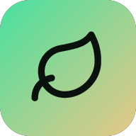

<!-- ============================================================
     Profile README — akanjb
     Sections: Header · About · AI & LLM Engineering · Tech Stack ·
               Fundamentals · Security · Featured Work · Live Projects · Analytics
     ============================================================ -->

<div align="center">


<a href="https://github.com/akanjb">
  
</a>

<br/>


</div>

---

## 🧠 About Me

```python
class NikunjBansal:
    """Engineer who turns research papers into shipped software."""

    role       = "AI Engineer · LLM Builder · Full-Stack & Systems Developer"
    builds     = ["LLMs from scratch", "AI agents", "agent skills", "MCP servers",
                  "RAG pipelines", "desktop apps", "browser extensions"]
    languages  = ["Python", "Rust", "TypeScript", "JavaScript", "Kotlin", "Java",
                  "Go", "C", "C++", "SQL", "HTML", "CSS", "Bash"]
    infra      = ["Docker", "Kubernetes", "Terraform", "AWS", "GCP", "Azure", "CI/CD"]
    principles = ["local-first", "privacy-first", "measure before optimizing",
                  "clean architecture", "ship it"]

    def currently(self) -> str:
        return "Building VEYRA — an AI usage intelligence monitor in Rust + Tauri"
```

---

## 🤖 AI & LLM Engineering

> From tokenizer to deployed agent — the full lifecycle of a modern language model.

<details open>
<summary><b>🏗️ Building LLMs from Scratch</b></summary>
<br/>

| Stage | What I work with |
|:--|:--|
| **Data** | Web-scale corpus curation, deduplication (MinHash / LSH), quality filtering, PII scrubbing, data mixtures, synthetic data generation |
| **Tokenization** | BPE, WordPiece, Unigram, SentencePiece, tiktoken, byte-level tokenizers, vocabulary design |
| **Architecture** | Transformers, multi-head / multi-query / grouped-query attention, RoPE & ALiBi, RMSNorm, SwiGLU, Mixture-of-Experts, state-space models (Mamba) |
| **Pre-training** | Next-token prediction, scaling laws (Chinchilla), mixed precision (BF16 / FP8), gradient checkpointing, learning-rate schedules, curriculum learning |
| **Distributed Training** | Data / tensor / pipeline / sequence parallelism, FSDP, DeepSpeed ZeRO, Megatron-LM, NCCL, multi-node GPU clusters |
| **Post-training** | Supervised fine-tuning, instruction tuning, RLHF (PPO), DPO, ORPO, KTO, GRPO, RLAIF, constitutional methods, reward modelling |
| **Efficient Fine-tuning** | LoRA, QLoRA, DoRA, adapters, prefix tuning, PEFT, Unsloth, Axolotl |
| **Inference & Serving** | KV cache, PagedAttention, FlashAttention, continuous batching, speculative decoding, vLLM, TGI, TensorRT-LLM, SGLang, llama.cpp, Ollama |
| **Compression** | Quantization (GPTQ, AWQ, GGUF, bitsandbytes, INT8 / INT4), pruning, knowledge distillation |
| **Evaluation** | Perplexity, MMLU, HumanEval, GSM8K, SWE-bench, LLM-as-a-judge, custom eval harnesses, regression evals |
| **Safety & Alignment** | Red-teaming, guardrails, jailbreak defence, prompt-injection mitigation, interpretability, hallucination detection |

</details>

<details open>
<summary><b>🕹️ AI Agents, Skills & Tooling</b></summary>
<br/>

| Area | What I work with |
|:--|:--|
| **Agent Design** | Tool use & function calling, ReAct, plan-and-execute, reflection, self-critique, long-horizon task decomposition |
| **Multi-Agent Systems** | Orchestrator-worker patterns, sub-agents, agent handoffs, A2A protocol, shared memory, consensus & voting |
| **Agent Frameworks** | LangGraph, LangChain, LlamaIndex, CrewAI, AutoGen, Semantic Kernel, DSPy, OpenAI Agents SDK, Claude Agent SDK, Google ADK |
| **Protocols** | Model Context Protocol (MCP) servers & clients, tool schemas, structured outputs, JSON mode |
| **Skill Creation** | Authoring reusable agent skills, slash commands, hooks, sub-agent definitions, skill evals and trigger optimization |
| **Context Engineering** | Prompt engineering, system prompts, few-shot design, context-window management, prompt caching, compaction |
| **Memory** | Short-term scratchpads, episodic & semantic memory, vector memory, knowledge graphs |
| **Agent Ops** | Tracing & observability (LangSmith, Langfuse, OpenTelemetry), cost & token tracking, sandboxing, human-in-the-loop |
| **AI Coding Agents** | Claude Code, Codex CLI, Gemini CLI, Copilot, Cursor, OpenCode — and the telemetry behind them |

</details>

<details>
<summary><b>🔎 Retrieval-Augmented Generation</b></summary>
<br/>

| Area | What I work with |
|:--|:--|
| **Embeddings** | Sentence transformers, OpenAI / Voyage / Cohere embeddings, Matryoshka embeddings, fine-tuned bi-encoders |
| **Vector Stores** | pgvector, Pinecone, Weaviate, Qdrant, Milvus, Chroma, FAISS |
| **Retrieval** | Hybrid search (BM25 + dense), re-ranking (cross-encoders, ColBERT), query rewriting, HyDE, multi-hop retrieval |
| **Pipelines** | Chunking strategies, document parsing, metadata filtering, GraphRAG, agentic RAG, citation grounding |

</details>

<details>
<summary><b>🧬 Deep Learning & Neural Networks</b></summary>
<br/>

| Area | What I work with |
|:--|:--|
| **Foundations** | Linear algebra, calculus, probability, optimization, backpropagation, automatic differentiation |
| **Architectures** | MLPs, CNNs, RNNs, LSTMs, GRUs, Transformers, ResNets, U-Nets, GNNs, autoencoders, VAEs, GANs |
| **Generative Models** | Diffusion models, latent diffusion, flow matching, autoregressive image & audio models |
| **Multimodal** | Vision Transformers, CLIP, vision-language models, Whisper / speech, text-to-speech |
| **Classical ML** | Regression, SVMs, decision trees, random forests, XGBoost, LightGBM, clustering, PCA, feature engineering |
| **Reinforcement Learning** | MDPs, Q-learning, DQN, policy gradients, PPO, actor-critic |
| **Frameworks** | PyTorch, JAX, TensorFlow, Keras, Hugging Face Transformers, scikit-learn, NumPy, pandas |
| **MLOps** | MLflow, Weights & Biases, DVC, Ray, Kubeflow, model registries, feature stores, ONNX, Triton |

</details>

<p align="center">
  
  
  
  
  
  
  
  
  
  
  
  
  
  
</p>

---

## 🛠️ Tech Stack

<table align="center">
  <tr>
    <td align="center" width="170"><b>Languages</b></td>
    <td></td>
  </tr>
  <tr>
    <td align="center"><b>Frontend</b></td>
    <td></td>
  </tr>
  <tr>
    <td align="center"><b>Backend</b></td>
    <td></td>
  </tr>
  <tr>
    <td align="center"><b>Desktop & Mobile</b></td>
    <td></td>
  </tr>
  <tr>
    <td align="center"><b>AI / ML</b></td>
    <td></td>
  </tr>
  <tr>
    <td align="center"><b>DevOps & Cloud</b></td>
    <td></td>
  </tr>
  <tr>
    <td align="center"><b>Databases</b></td>
    <td></td>
  </tr>
  <tr>
    <td align="center"><b>Tools & OS</b></td>
    <td></td>
  </tr>
</table>

<details>
<summary><b>☸️ Docker & Kubernetes in depth</b></summary>
<br/>

| Area | What I work with |
|:--|:--|
| **Containers** | Dockerfiles, multi-stage builds, BuildKit, Docker Compose, distroless & minimal images, image scanning, registries |
| **Kubernetes** | Pods, Deployments, StatefulSets, DaemonSets, Jobs, Services, Ingress, ConfigMaps, Secrets, RBAC, HPA / VPA |
| **Ecosystem** | Helm, Kustomize, Argo CD, Flux, Istio, Linkerd, cert-manager, KEDA, Karpenter, operators & CRDs |
| **Platforms** | EKS, GKE, AKS, k3s, kind, minikube, GPU node pools for model training & serving |
| **Observability** | Prometheus, Grafana, Loki, Jaeger, OpenTelemetry, alerting & SLOs |
| **IaC & Delivery** | Terraform, Pulumi, Ansible, GitHub Actions, GitLab CI, Jenkins, GitOps workflows |

</details>

---

## 📐 Engineering Fundamentals

<details>
<summary><b>Computer science & software craftsmanship</b></summary>
<br/>

| Area | Topics |
|:--|:--|
| **Data Structures & Algorithms** | Arrays, linked lists, stacks, queues, trees, heaps, tries, graphs, hashing, DP, greedy, backtracking, complexity analysis |
| **Operating Systems** | Processes & threads, scheduling, memory management, virtual memory, file systems, concurrency, synchronization |
| **Computer Networks** | OSI & TCP/IP, HTTP/1.1–3, TLS, DNS, WebSockets, gRPC, REST, load balancing, CDNs |
| **Databases** | Relational modelling, normalization, indexing, transactions & ACID, isolation levels, query planning, NoSQL trade-offs |
| **System Design** | Scalability, caching, sharding, replication, queues, rate limiting, CAP theorem, consistency models, microservices |
| **Distributed Systems** | Consensus (Raft, Paxos), event sourcing, CQRS, idempotency, back-pressure, observability |
| **Software Design** | OOP, functional programming, SOLID, DRY, design patterns, clean architecture, domain-driven design |
| **Quality** | Unit, integration & E2E testing, TDD, property-based testing, code review, static analysis, CI/CD |
| **Low-level** | Memory safety, ownership & borrowing, compilers & interpreters, concurrency primitives, performance profiling |

</details>

---

## 🔐 Security & Ethical Hacking

<details>
<summary><b>Offensive & defensive security basics</b></summary>
<br/>

| Area | Topics |
|:--|:--|
| **Web Security** | OWASP Top 10, XSS, CSRF, SQL injection, SSRF, IDOR, auth & session flaws, CSP, secure headers |
| **Network & Recon** | Nmap, Wireshark, packet analysis, enumeration, port scanning, traffic inspection |
| **Tooling** | Kali Linux, Burp Suite, Metasploit, Hydra, John the Ripper, Gobuster, sqlmap |
| **AI Security** | Prompt injection, jailbreaks, data exfiltration via tools, model supply-chain risks, LLM red-teaming |
| **Practice** | CTF challenges, reverse-engineering basics, cryptography fundamentals, secure-by-design development |

</details>

<p align="center">
  
  
  
  
  
</p>

---

## 🚀 Featured Work

<div align="center">

<a href="https://github.com/akanjb/VEYRA">
  
</a>

</div>

### [VEYRA](https://github.com/akanjb/VEYRA) — AI Usage Intelligence Monitor

A **local-first, privacy-first desktop dashboard** that unifies AI usage across model providers, coding agents, IDEs and CLIs into one accurate view.

- 📊 Tracks **tokens, API-equivalent cost, cache savings, sessions, models and projects**
- 🔌 Connectors for **Claude Code, Codex, Gemini CLI, OpenCode and Copilot CLI**, plus an opt-in local OpenTelemetry receiver and capture proxy
- 🧮 Verified pricing engine where **every number is marked exact or estimated**
- 🔒 **No telemetry, no accounts** — prompts are never stored; everything stays on your machine
- 🧱 Built with **Tauri 2 · Rust · React 19 · SQLite**, with generated contracts, accessibility checks and CI

<p>
  
  
  
  
  
</p>

> 🔒 **Plus 20+ private projects** — cross-browser extensions, a Tauri desktop app, fintech & equity-research tools, and productivity software.

---

## 🌐 Live Projects

<div align="center">

> Shipped, deployed and one click away — tap a button to open the real thing.


<br/><br/>

<!-- ───── Flagship app ───── -->
<table width="100%">
  <tr>
    <td align="center" valign="middle" width="190" bgcolor="#1a1b27">
      <a href="https://finevergreen.netlify.app/"></a>
    </td>
    <td align="left" valign="middle" bgcolor="#1a1b27">
      
      
      
      <h3><a href="https://finevergreen.netlify.app/">FinEvergreen</a> — Ultimate Personal Finance App</h3>
      A secure, premium personal-finance app to track <b>income, expenses and transfers across multiple currencies</b>. It brings <b>budgets, goals, debt payoff, EMIs and planned payments</b> together with <b>smart insights, forecasts, a financial health score and 31 calculators</b> — plus Excel/CSV exports, reminders and App Lock. Runs on any device, and is built to run entirely on free services: <b>no paid APIs, no paid infrastructure</b>.
      <br/><br/>
      <a href="https://finevergreen.netlify.app/"></a>
    </td>
  </tr>
</table>

<br/>

### 🧩 Browser Extensions &nbsp;·&nbsp; Chrome & Edge

<table width="100%">
  <!-- logos -->
  <tr>
    <td align="center" width="33%" bgcolor="#1a1b27">
      <br/><a href="https://chromewebstore.google.com/detail/flowt-distraction-blocker/gblmoccpmpbiclnbkdciglogchofmocj"></a>
    </td>
    <td align="center" width="33%" bgcolor="#1a1b27">
      <br/><a href="https://chromewebstore.google.com/detail/screener-smart-research/egbpfmckeohieknjdpaojnblbpconcff"></a>
    </td>
    <td align="center" width="33%" bgcolor="#1a1b27">
      <br/><a href="https://chromewebstore.google.com/detail/paceline-%E2%80%94-video-speed-co/igjjphgdnojmjalgpklbdhpmhljfaglo"></a>
    </td>
  </tr>
  <!-- names -->
  <tr>
    <td align="center" bgcolor="#1a1b27"><b>Flowt</b><br/><sub>YouTube distraction blocker</sub></td>
    <td align="center" bgcolor="#1a1b27"><b>Screener Smart Research</b><br/><sub>Analyst-grade research on Screener.in</sub></td>
    <td align="center" bgcolor="#1a1b27"><b>Paceline</b><br/><sub>Video speed controller</sub></td>
  </tr>
  <!-- descriptions -->
  <tr>
    <td align="center" valign="top" bgcolor="#1a1b27"><sub>Blocks Shorts, the home feed, suggestions and autoplay — with focus timers, daily limits and schedules.</sub></td>
    <td align="center" valign="top" bgcolor="#1a1b27"><sub>Ratios, forensic scores, DuPont, ROIIC, reverse DCF and peer comparison. Free, runs locally.</sub></td>
    <td align="center" valign="top" bgcolor="#1a1b27"><sub>Set the speed of any HTML5 video — YouTube, Netflix, Prime Video and more — from 0.25× to 2.5×.</sub></td>
  </tr>
  <!-- Chrome buttons -->
  <tr>
    <td align="center" bgcolor="#1a1b27"><a href="https://chromewebstore.google.com/detail/flowt-distraction-blocker/gblmoccpmpbiclnbkdciglogchofmocj"></a></td>
    <td align="center" bgcolor="#1a1b27"><a href="https://chromewebstore.google.com/detail/screener-smart-research/egbpfmckeohieknjdpaojnblbpconcff"></a></td>
    <td align="center" bgcolor="#1a1b27"><a href="https://chromewebstore.google.com/detail/paceline-%E2%80%94-video-speed-co/igjjphgdnojmjalgpklbdhpmhljfaglo"></a></td>
  </tr>
  <!-- Edge buttons -->
  <tr>
    <td align="center" bgcolor="#1a1b27"><a href="https://microsoftedge.microsoft.com/addons/detail/flowt-distraction-block/icmenkknlhmognjdckaicocebbdedgik"></a></td>
    <td align="center" bgcolor="#1a1b27"><a href="https://microsoftedge.microsoft.com/addons/detail/screener-smart-research/ioignhkdficolihednbemdblahhgioai"></a></td>
    <td align="center" bgcolor="#1a1b27"><a href="https://microsoftedge.microsoft.com/addons/detail/paceline-%E2%80%94-video-speed-co/beknokklkkdlkmmffbjecodpkpfnflib"></a></td>
  </tr>
  <tr><td colspan="3" bgcolor="#1a1b27"></td></tr>
</table>

<br/>

### 📱 More Apps

<!-- TODO: add live-demo / store buttons here once public links for these three apps are available -->
<table width="100%">
  <tr>
    <td align="center" valign="top" width="33%" bgcolor="#1a1b27"><br/>⏱️<br/><b>Ultimate Productivity Tracker</b></td>
    <td align="center" valign="top" width="33%" bgcolor="#1a1b27"><br/>💸<br/><b>Income & Expense Tracker</b></td>
    <td align="center" valign="top" width="33%" bgcolor="#1a1b27"><br/>📊<br/><b>Trading Risk & Money Management Calculator</b></td>
  </tr>
  <tr>
    <td align="center" valign="top" bgcolor="#1a1b27"><sub>A modern productivity app built on proven principles and techniques to fight procrastination, sharpen focus and maximise efficiency.</sub></td>
    <td align="center" valign="top" bgcolor="#1a1b27"><sub>A dedicated mobile app for tracking and managing personal finances — income, spending and where the money goes.</sub></td>
    <td align="center" valign="top" bgcolor="#1a1b27"><sub>A professional-grade calculator for traders and scalpers — risk, position sizing and money management in one place.</sub></td>
  </tr>
  <tr>
    <td align="center" valign="top" bgcolor="#1a1b27">
      
    </td>
    <td align="center" valign="top" bgcolor="#1a1b27">
      
      
      <br/>
      
      
      
    </td>
    <td align="center" valign="top" bgcolor="#1a1b27">
      
      
      <br/>
      
      
      
    </td>
  </tr>
</table>

<br/>

### 🔒 Not Publicly Deployed (Yet)

<table width="100%">
  <tr>
    <td align="center" bgcolor="#1a1b27">
      
      <br/><br/>
      🖥️ <b>Desktop application</b> for <b>macOS & Linux</b> &nbsp;·&nbsp; 🧩 <b>More browser extensions</b> &nbsp;·&nbsp; 🧪 <b>Other projects</b> still being built and polished before release.
    </td>
  </tr>
</table>

</div>

---

## 📈 GitHub Analytics

<div align="center">


<picture>
  <source media="(prefers-color-scheme: dark)" srcset="https://raw.githubusercontent.com/akanjb/akanjb/output/github-snake-dark.svg" />
  <source media="(prefers-color-scheme: light)" srcset="https://raw.githubusercontent.com/akanjb/akanjb/output/github-snake.svg" />
  
</picture>

</div>

---

<div align="center">

### 💬 Let's build something intelligent

<a href="https://github.com/akanjb"></a>


<sub><i>P.S. This profile is written half-seriously and for fun — VEYRA and the live projects above are the real parts.</i></sub>

</div>
